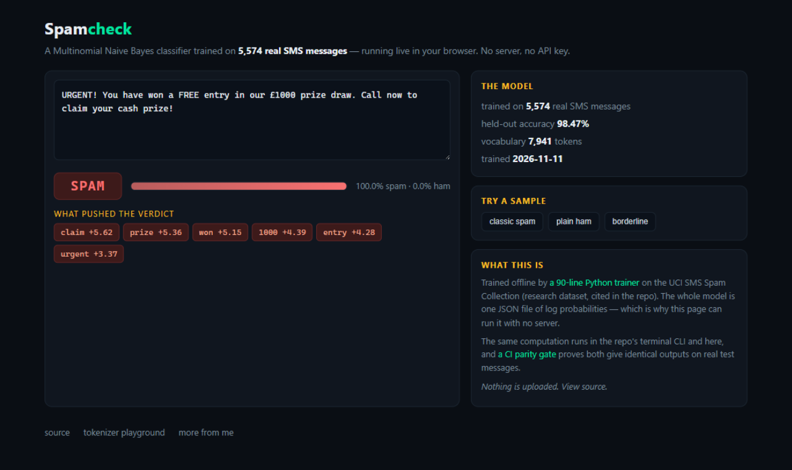

# spamcheck

[](https://github.com/amanvicky/spamcheck/actions/workflows/ci.yml)

A **trained spam classifier** — Multinomial Naive Bayes learned from **5,574 real SMS messages** (UCI SMS Spam Collection) — shipped as one JSON file of log probabilities, running **identically in your terminal and your browser**.

**Try it live: [amanvicky.github.io/spamcheck](https://amanvicky.github.io/spamcheck/)** — type a message, see the verdict, and *which words pushed it*.



## The numbers (held-out test split, 1,114 messages the model never saw)

| Metric | Value |
|---|---|
| Accuracy | **98.47%** |
| Precision (spam) | 97.83% |
| Recall (spam) | 90.60% |
| F1 (spam) | 94.08% |

Every CI run recomputes accuracy from the shipped artifacts and fails the build below 95%.

## Why two runtimes

The whole model is `model.json`: class priors plus one log-probability per token. That makes the inference math trivially portable — so the repo ships it twice, and a **CI parity gate** (`parity-check.mjs`) proves the JavaScript and the Python produce identical verdicts and probabilities (to 9 decimal places) on real held-out messages, spam and ham:

```
msg  3: py=spam/1.000000 js=spam/1.000000 verdict-ok prob-ok truth=spam
msg  7: py=spam/0.999958 js=spam/0.999958 verdict-ok prob-ok truth=spam
parity: JS === Python on all samples
```

Same pattern as my [tokenizer-playground](https://github.com/amanvicky/tokenizer-playground): two implementations that must agree, checked by CI.

## What the model says, out loud

The CLI doesn't just print a verdict — it shows the tokens that pushed it:

```bash
$ python spamcheck.py "URGENT! You have won a FREE prize, call now to claim your cash prize!"
SPAM  100.0%
  'claim'              pushes spam  (Δlog +5.62)
  'prize'              pushes spam  (Δlog +5.36)
  'won'                pushes spam  (Δlog +5.15)
  '1000'               pushes spam  (Δlog +4.39)

$ python spamcheck.py "hey are we still meeting at the library at 5?"
HAM  100.0%
  'meeting'            pushes ham  (Δlog -2.61)
  'hey'                pushes ham  (Δlog -1.85)
```

The browser demo shows the same contributions as chips — red pushes spam, green pushes ham.

## Training, reproducible

```bash
pip install scikit-learn  # only if you want to verify against sklearn
python train_model.py     # re-trains from data/raw, re-splits (seed 7), re-evaluates
pytest tests/ -q          # 9 tests, incl. the accuracy floor
```

The trainer is hand-rolled Multinomial NB (~90 lines) — not sklearn — written out so the exported JSON *is* the training math. Split is stratified 80/20, seed 7, deterministic. `data/train.jsonl` and `data/test.jsonl` ship in the repo so every number is reproducible.

Dataset: [SMS Spam Collection v.1](https://archive.ics.uci.edu/dataset/228/sms+spam+collection), UCI Machine Learning Repository (id 228) — Almeida, Hidalgo & Ling (2011). Used for research/education with the citation the license requires.
